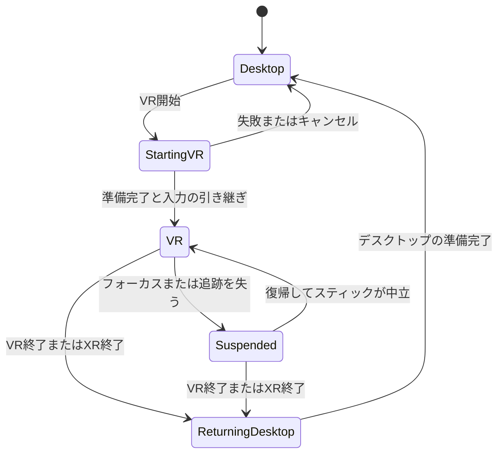

# セッションを保ったままデスクトップとVRを切り替える計画

状態：当初の計画。初期実装の操作と制限は[デスクトップとVRの切り替え](vr.md)を参照。実機確認は未完了。
確認日：2026-10-28。初期の実機検証対象はValve Index（ユーザー確認済み）。Windows版tukuriumで、SteamVRをOpenXRランタイムとして使う。

**最初はHMDでの見回しと移動に絞り、参加中のセッションを保ってVRへ入り、デスクトップへ戻れるようにする。**
SteamVRはtukuriumの起動後に起動してよい。VR用の編集操作は後の段階にする。

基本案は、Rust Engineと同期接続を動かしたまま、必要に応じてGodotの表示クライアントを起動し直す方式とする。
Godot 4.7.2では、GDScriptの`initialize()`と`uninitialize()`だけでOpenXR全体を作り直せるとは判断できない。
画面が一時的に切り替わることと、ワールドから退出することを区別する。

初期実装ではデスクトップの表示プロセスを閉じずに待機させ、VR用の表示だけを起動・終了する方式を採用した。
これによりデスクトップの入力途中の下書きを保持し、VR終了・起動失敗時の復帰先も残せる。
左Bで開く個人メニューと、右手のレーザー・トリガーでの操作を追加した。以降の段階分けは当初の計画として残す。

## 最初に使えるようにする操作

1. 普通に起動し、デスクトップでセッションへ参加する。この時点ではOpenXRを起動しない。
2. 必要になったらSteamVRを起動し、HMDを使える状態にする。
3. 個人メニューの「VR開始」を押す。準備が整うまで現在の画面を残し、HMDへ切り替える。
4. HMDで見回し、コントローラーのスティックで移動する。
5. 「デスクトップに戻る」を選ぶと、その時点のアバター位置でデスクトップ操作を再開する。

VR中もPC窓には終了操作を残す。最小版では状態表示と終了ボタンを用意し、ゲーム内の戻るボタンにも同じ終了操作を割り当てる。
SteamVRのシステムメニューボタンは奪わない。物体の編集やライブラリ操作が必要なときはデスクトップへ戻る。

| 場面 | 期待する動作 |
|---|---|
| SteamVRを起動していない、HMDがない、初期化に失敗 | デスクトップを続け、確認事項と再試行を表示する |
| SteamVRだけを後から起動 | 自動では視点を奪わず、本人の「VR開始」で切り替える |
| HMDを外す、SteamVRのメニューを開く | VRの入力を止める。セッション・保存・同期は続ける |
| 再び装着し、入力フォーカスと追跡が戻る | スティックが中立に戻ったことを確認して移動を再開する |
| VR終了を選ぶ、SteamVRを終了する、XRセッションを失う | デスクトップへ復帰する。tukurium全体は終了しない |
| SteamVRをもう一度起動 | 新しいVR開始操作で入り直せる |

初期の移動案はIndexコントローラーを想定し、左スティックでHMDの水平な向きを基準に前後左右へ移動し、右スティックで30度ずつ向きを変える方式とする。
連続回転、テレポート、ジャンプのVR割り当て、両手の表示・同期、把持、パネル編集、全身IKは後続の対象とする。
最初の完了判定はIndexで行う。他のHMDと接続方式への対応は、その後に検証対象を広げる。

## 使用中のGodotには起動と終了の制約がある

手元の実行ファイルは`4.7.2.stable.official.ed1daf0bf`。現行の[project.godot](../client-godot/project.godot)は`gl_compatibility`を使い、XR設定はまだない。

公式の[OpenXR Settings](https://docs.godotengine.org/en/stable/tutorials/xr/openxr_settings.html)には、Vulkan以外では実行中に初期化できるという説明がある。
ただし、使用版に合わせたソースには次の制約があるため、その説明だけで後付け対応を確約しない。

- [register_types.cpp](https://github.com/godotengine/godot/blob/4.7.2-stable/modules/openxr/register_types.cpp)は、起動時にOpenXRのAPIを生成する。初期化に失敗したAPIは破棄する。
- [openxr_interface.cpp](https://github.com/godotengine/godot/blob/4.7.2-stable/modules/openxr/openxr_interface.cpp)の`initialize()`は、そのAPIが既に初期化済みであることを要求する。`uninitialize()`はトラッカーなどを解放するが、OpenXRのセッションとインスタンスを完全に破棄する処理にはなっていない。
- [openxr_api.cpp](https://github.com/godotengine/godot/blob/4.7.2-stable/modules/openxr/openxr_api.cpp)では、セッションとインスタンスの破棄は`finish()`に分かれている。

以上から、**配布済みGodotを使う初期案では表示プロセスの切り替えを基本とする。**
同一プロセスでの完全な遅延初期化・再初期化は、最小の試作で確認し、必要ならGodotの改修として別途評価する。
単にViewportの`use_xr`を外すだけでは、SteamVRとの接続を終了したことにはならない。

表示プロセスを切り替える方式なら、将来Vulkanへ移行するときもXRの起動条件を分けられる。
今回の初期対応では描画方式の変更まで同時に行わない。
SteamVRを有効なOpenXRランタイムにする設定は利用者が行い、tukuriumからシステム全体の設定を書き換えない。
ここまでの外部資料の確認日は2026-10-28。再初期化の成否は実機では未検証。

## Engineを維持し、表示の切り替えを一か所で管理する

Engineは既に複数の表示接続を受け入れ、移動入力の所有者を接続単位で管理している。
[start-local.ps1](../scripts/start-local.ps1)にも、稼働中のEngineへGodotだけを開き直す処理がある。
この構成を土台にするが、現在の起動処理だけでモード切り替えが完成しているわけではない。

アプリ側の状態はOpenXRの状態と分ける。

切り替え管理には、開始要求、準備完了、失敗、キャンセル、終了を集約する。
ボタンの連打、古い起動処理からの応答、XR終了通知の重複があっても、入力を担当する表示接続は一つにする。
新しい制御情報は端末内の一時状態として既存のIPC・要求応答へ載せる。共有ワールドへVRフラグを書いたり、Goアダプターに切り替え規則を持たせたりしない。

### 切り替え中も既存の表示を復帰先として残す

1. 入力中の値や未完了の編集要求がある場合は切り替えを待つ。下書きを捨てたり、結果不明の要求を再送したりしない。保持・ギズモのプレビューは共通のキャンセル処理で終える。
2. 移動入力をゼロにし、旧接続からの入力送信を止める。新しい表示を待機状態で起動する。
3. 新しい表示は同じEngineへ接続し、現在のセッション、参加者、ワールド、移動状態を取得する。起動引数の`lobby`を理由に再参加・セッション作成を行わない。
4. 描画準備を確認した後、Engineで入力の担当を引き継ぐ。旧接続の入力停止を確認するまで新接続は移動を送らない。
5. 新表示が使えるようになったら旧表示を閉じ、記録されたGodotのPIDを更新する。失敗時は旧表示で続ける。

既存の入力所有者には250msの失効処理があるが、通常の引き継ぎをタイムアウト任せにしない。
旧表示が予期せず終了した場合に限り、既存の失効処理を最後の停止手段として使う。
待機中の新表示が送る`active=false`も旧表示を止め得るため、待機接続からは`player_input`自体を送らない。
IPC切断後の後処理が、新表示へ渡した入力の所有権を消さないことも確認する。

VR開始時のGodotは`--xr-mode on`、デスクトップは`--xr-mode off`を指定する案とする。
VR開始失敗の通知は独自UIで扱い、Godotの起動時モーダルは抑制する。
SteamVRの初期化が停止しても旧画面からキャンセルできるよう、起動には期限を設ける。
強制停止の対象は今回起動した表示プロセスだけに限定する。

[crates/supervisor](../crates/supervisor/src/supervisor.rs)には、一つの子プロセス終了を受けて全体を終了する経路がある。
このSupervisorを使う起動経路では、表示の交換とアプリ全体の終了を区別する改修が必要になる。
現行PowerShellのプロセス記録と別々の管理者を作らず、採用する起動経路で整合させる。
Engine・アダプター・認証・ホストの保存処理は継続する。

## HMDの見回しは即時に反映し、移動はRustで計算する

VR用の視点には`XROrigin3D`と`XRCamera3D`を使う。
既存のFPS処理は毎フレーム`camera.position`と`camera.rotation`を上書きするため、その更新対象からXRカメラを外す。
視点の取得を共通化し、デスクトップ・VR・撮影カメラのどれを参照しているかを明確にする。

- HMDの回転と位置はGodotの追跡結果をそのフレームで表示する。Rustから返る姿勢で頭を補間し直さない。
- スティック入力は既存の`PlayerInput`へ変換し、速度・重力・衝突・足場への追従を[locomotion.rs](../crates/core/src/locomotion.rs)で計算する。
- Rustが返したアバターの足元位置をXR空間の基準にする。既存FPSの目の高さ1.15mをHMDの高さへ二重に加えない。
- 初期版の他参加者への共有は既存の位置・yaw・pitchで行う。HMDのrollや実際の頭のオフセット、手の姿勢はまだ表現しない。共有するpitchは既存の検証範囲へ収める。
- 頭を上下へ向けても水平移動の速度を変えない。ほぼ真上・真下を見たときは最後の有効な水平向きを使う。

初期版は座位・立位でのスティック移動を対象とする。身体を大きく動かすルームスケール移動は別の段階にする。
HMDの実移動とアバターの衝突位置は同じではない。開始時に水平位置を合わせ、許容範囲を超える身体移動や壁への接近ではローカルなフェードと再センタリング案内を行う。
その判定に必要な形状情報はRust側から得て、Godotに別の移動・衝突ルールを作らない。
スナップ回転はHMDの現在の水平位置を中心に行い、部屋の原点を中心に頭が円運動することを避ける。
この部分は[Room scale in XR](https://docs.godotengine.org/en/stable/tutorials/xr/xr_room_scale.html)が示す課題を踏まえた提案であり、許容範囲とフェード条件は試作時に決める。

デスクトップへ戻るときは、FPS/TPSの種類を復元し、最新のアバター位置を使う。
Fly cameraは復帰時のHMD視点付近から再開する案とし、切り替え前のアバター位置へ巻き戻さない。
マウスは解放状態へ戻し、ワールドをクリックして操作を始める。

## 入力フォーカスと描画の停止を切り分ける

現在の[main.gd](../client-godot/main.gd)は、アプリのフォーカス喪失で`release_cursor()`を呼ぶ。
VRの入力可否にはOpenXRのフォーカス・追跡状態を使い、PC窓が背面にあるだけでVR操作が止まらないようにする。
HMDを外した検出だけに依存せず、入力フォーカス喪失、追跡無効、セッション終了のいずれでも移動を停止する。

[OpenXRInterface](https://docs.godotengine.org/en/stable/classes/class_openxrinterface.html)の`session_visible`は、映像が出ていてもXR入力を受け取れない状態を含む。
`session_stopping`、`session_loss_pending`、`instance_exiting`はデスクトップへの復帰処理へ集約する。
XR全体を終了させる通知と一時的な入力停止を同じ扱いにしない。

追跡やフォーカスを失ってもSceneTree全体を一時停止しない。Godotの通信処理、動画時刻、Rustのシミュレーションと保存は動かし続ける。
コントローラーがなくても見回しとPC側からのVR終了を可能にする。キーボード移動はPC窓にフォーカスがある場合の補助とする。

VRの描画は専用Viewportに分け、同じ`World3D`を参照する案とする。
PC側の終了UIは通常の2D表示に置く。個人のVR終了UIを共有WorldPanelとして生成しない。
スケールは1mを基準とし、ウィンドウサイズを変えてもHMDの投影へ反映させない。
VR中は通常モニターのVSyncやフレーム上限がHMDの更新を制限しないようにし、復帰時にはデスクトップ設定を戻す。
Rustの固定60HzとHMDの描画周期を分離し、頭の追跡を60Hzに制限しない。

自分のアバターは既存の専用レイヤーを使い、HMD用カメラからだけ隠す。
鏡は現在単眼のCamera3Dを前提にしているため、初期版ではVR側の反射表示を一時的に無効にする案とする。共有された鏡のデータは変更しない。
立体視に合う反射、PC窓への映像ミラー、撮影機能との同時利用は、負荷を測ってから追加する。
共有3Dパネルとアセットの通常表示は初期版の描画確認に含める。

## 実装は切り替えの成立を先に確かめる

| 段階 | 作業と完了条件 |
|---|---|
| 1. 使用版で最小検証 | Godot 4.7.2で起動時XRの成功・失敗、遅延初期化、終了と再試行を確認する。同一プロセスで成立する範囲を記録し、表示交換の必要条件を確定する |
| 2. 表示の引き継ぎ | 既存Engineに対して待機中の表示を起動し、準備完了後に入力を引き継ぐ。失敗・キャンセル時の復帰、プロセス記録、未完了編集を扱う。HMDなしで検証できる |
| 3. 見回しと移動 | XRカメラ、スティック、スナップ回転、再センタリング、入力停止、ローカル終了操作を追加する。壁・足場・頭のオフセットを実機確認する |
| 4. 往復と異常終了 | 同じセッションでVRを繰り返し開始・終了し、SteamVR再起動後も入り直せることを確認する。既存のデスクトップ入力と描画の回帰を確認する |

主な変更先は`client-godot`の視点・入力・個人メニュー、新設するXR切り替え管理、Engineの表示接続と入力所有者、採用するランチャーのプロセス管理になる。
頭と手の詳細な共有を始めるまでは、ワールド保存形式を増やさない。将来追加する共有データはComponent登録表と既存の同期経路へ通す。

## 完了は実機の往復と既存操作の両方で判定する

自動テストには表示の準備完了・失敗を代替する経路を用意し、実際のメニュー入力から切り替え管理とEngineまで通す。
新設予定の`tests/vr-switch-integration.mjs --rendered`では、連打、準備失敗、タイムアウト、キャンセル、旧接続の遅れた切断、入力の二重送信を確認する。
切り替え前後でEngineのPID、参加者ID、セッションIDが一致し、ワールドrevisionが切り替えだけでは増えないことを確認する。
ホスト・ゲスト・第三者の観測を使い、再入室通知やアバターの巻き戻りがないこと、切り替え中も保存が続くことを確認する。

Valve Indexの実機では次を確認し、GPU、SteamVRとGodotの版、使用するコントローラーと接続構成を記録する。

- SteamVR停止中のデスクトップ起動 → SteamVR起動 → VR開始 → デスクトップ復帰を10回繰り返す。
- VR中にSteamVRを終了し、デスクトップ復帰後にSteamVRを再起動してVRへ入り直す。
- HMD未接続、起動失敗、装着解除、追跡喪失、システムメニュー、PC窓のフォーカス喪失、コントローラー切断を試す。
- 座位・立位、再センタリング、上下を見ながらの移動、頭が原点からずれた状態の回転、壁・段差・動く足場を試す。
- VR終了後にFPS/TPS/Fly camera、文字入力、Esc、保持、新規作成、共有パネル、鏡を使う。
- HMDのリフレッシュレートに対するCPU/GPU時間を記録する。空のワールドと既存アセット・パネルを置いたワールドを分ける。

既存の回帰確認には`tests/hud-integration.mjs --rendered`、`tests/ui-focus-integration.mjs --rendered`、`tests/creation-integration.mjs --rendered`、`tests/panels-integration.mjs --rendered`、`tests/avatar-integration.mjs`を変更範囲に応じて使う。
Rustの入力引き継ぎを変える場合は関連テストを実行し、共有・保存への影響を確認する。
実行ファイルの前提は各テストのソースで確認する。機器なしのテストが通ったことを、実機の初期化・立体視・再接続の成功とは扱わない。

最初に確定させるのは、使用HMDで「後からVR開始、終了、SteamVR再起動後の再開始」が成立する表示の切り替え方式である。
その結果を踏まえて見回しと移動を追加し、VRでの編集は次の計画へ分ける。
